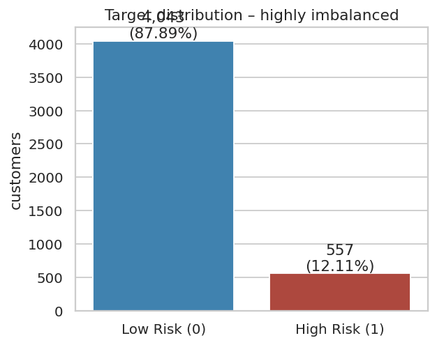
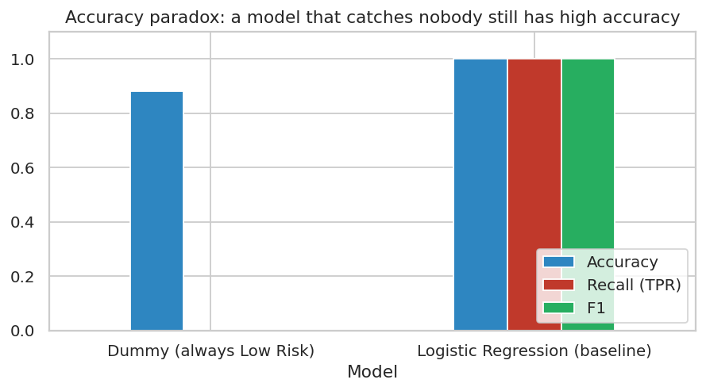
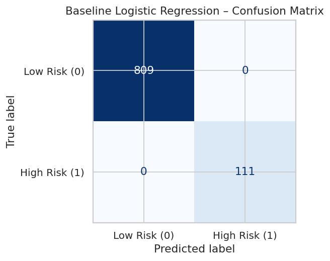
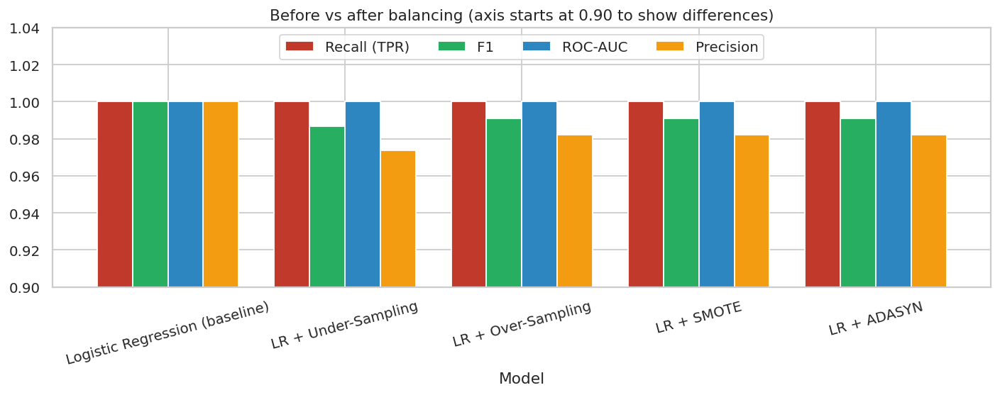
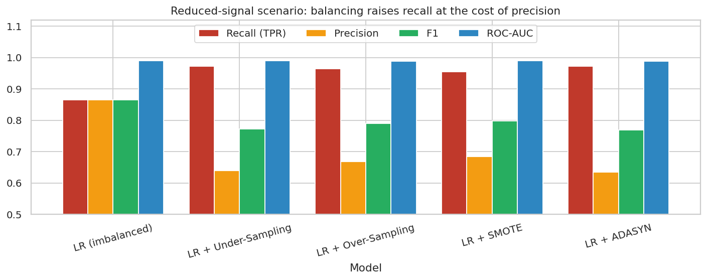
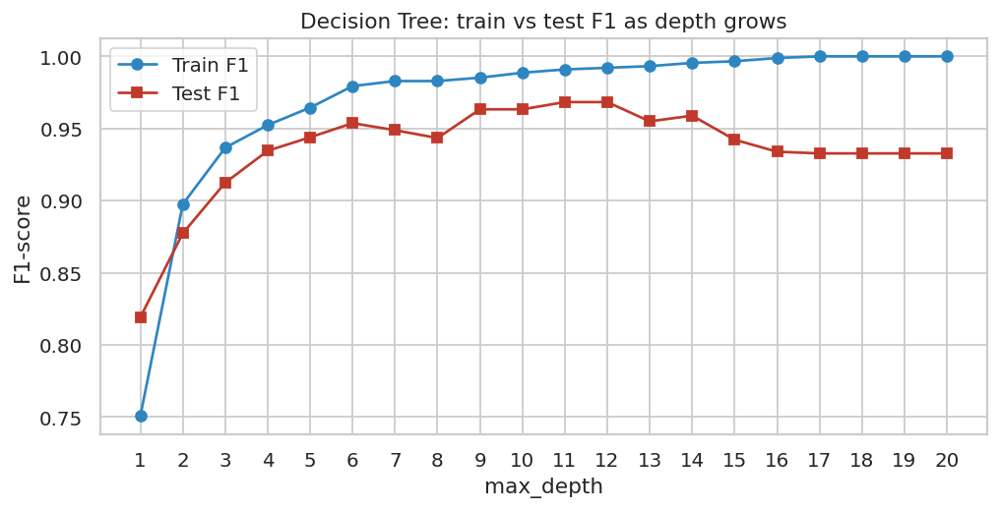
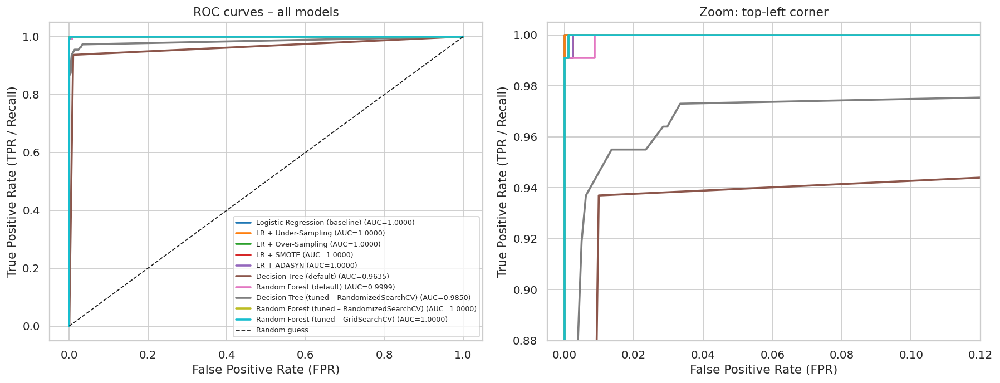
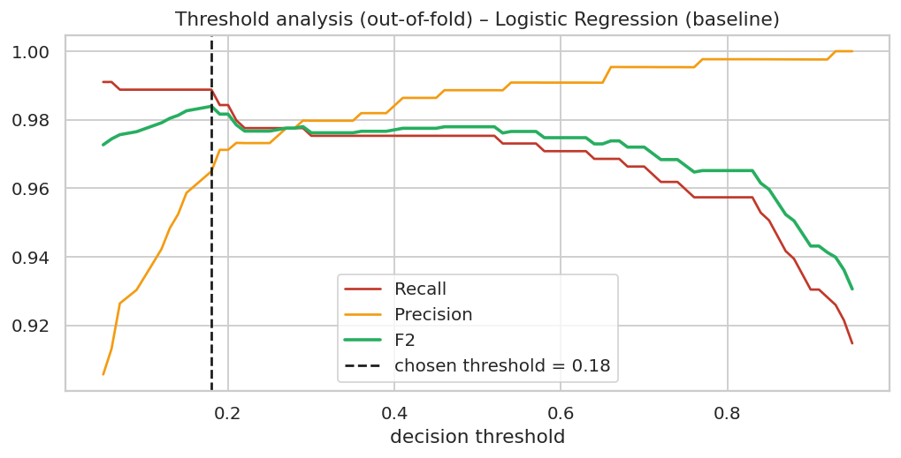
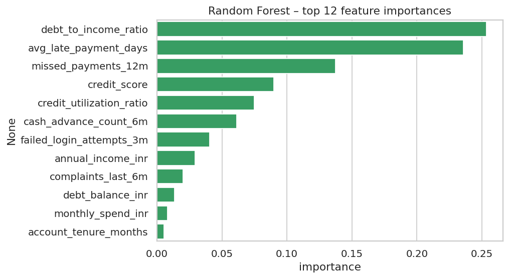
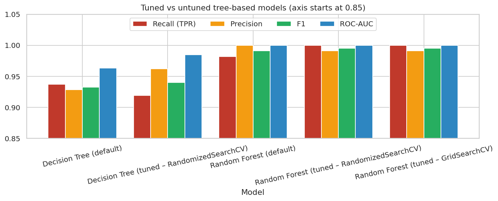

# 🚨 Risk Alert Classifier

**An early-warning machine-learning system that identifies high-risk customers of a digital banking platform.**
Supervised learning · Classification · Imbalanced data (Under/Over-sampling, SMOTE, ADASYN) · Hyper-parameter tuning · Streamlit app

> Project for **Red & White Skill Education – Supervised Learning** (duration: 6 hours, 10 marks)

| | |
|---|---|
| 🔗 **Live Streamlit app** | `https://<your-app-name>.streamlit.app` ← *replace after deploying (see [Deployment](#-deploy-the-streamlit-app))* |
| 🎥 **Video explanation** | `<Google Drive sharable link or YouTube unlisted link>` ← *replace after uploading* |
| 📓 **Notebook** | [`Risk_Alert_Classifier.ipynb`](Risk_Alert_Classifier.ipynb) |
| 📄 **Theory PDF** | [`docs/Theory_Concepts.pdf`](docs/Theory_Concepts.pdf) |
| 👤 **Author** | `<Your Name>` |

---

## 📑 Table of contents
1. [Problem statement & business goal](#1--problem-statement--business-goal)
2. [Repository structure](#2--repository-structure)
3. [Dataset](#3--dataset)
4. [Approach – step by step](#4--approach--step-by-step)
5. [Results](#5--results)
6. [Key findings & honest caveats](#6--key-findings--honest-caveats)
7. [Installation & how to run](#7--installation--how-to-run)
8. [The Streamlit app](#8--the-streamlit-app)
9. [Deploy the Streamlit app](#-deploy-the-streamlit-app)
10. [Publish to GitHub](#-publish-to-github)
11. [Task-to-notebook map (all 27 tasks)](#11--task-to-notebook-map-all-27-tasks)
12. [Submission checklist & marking criteria](#12--submission-checklist--marking-criteria)
13. [Limitations & future work](#13--limitations--future-work)

---

## 1. 🎯 Problem statement & business goal
A digital bank wants an **early-warning system** that flags customers who are likely to **default on payments or engage in fraudulent behaviour** (`risk_status = 1`). Risky customers are a small minority, so the data are **highly imbalanced** (≈ 12 % high-risk).

The task is to build a robust classification pipeline that
* accurately identifies high-risk customers,
* handles the class imbalance effectively,
* is evaluated with *appropriate* metrics (not accuracy alone),
* is improved with hyper-parameter tuning.

**Business rule used for model selection:** a *missed* high-risk customer (false negative / Type-II error) is far more expensive than a *false alarm* (false positive / Type-I error – one extra manual review). The final model is therefore chosen to **minimise false negatives**.

---

## 2. 📁 Repository structure
```
risk-alert-classifier/
├── README.md                          ← you are here
├── Risk_Alert_Classifier.ipynb        ← full solution, Parts A–H (all 27 tasks, outputs included)
├── app.py                             ← Streamlit web app
├── risk_utils.py                      ← shared preprocessing pipeline (feature engineering + KNN imputer + encoding) & CV helpers
├── train_model.py                     ← re-trains the final model and writes models/
├── requirements.txt                   ← Python dependencies
├── data/
│   └── Risk_Alert_Classifier_Dataset_4600.csv
├── models/
│   ├── risk_model.joblib              ← fitted sklearn Pipeline (preprocessing + final model)
│   ├── model_meta.json                ← metrics, threshold, ROC points, feature importances, UI option lists
│   └── model_comparison.csv           ← test-set metrics of every model in the notebook
├── screenshots/                       ← all charts/plots produced by the notebook (evidence for submission)
├── docs/
│   ├── Theory_Concepts.pdf            ← definitions of all theory concepts (Part A + glossary)
│   └── Video_Script.md                ← talking points for the 5–10 minute video
└── .streamlit/config.toml             ← app theme
```

---

## 3. 📊 Dataset
`data/Risk_Alert_Classifier_Dataset_4600.csv` – **4,600 customers × 19 columns**, one row per customer.

| Column | Type | Description (interpreted from the column name) |
|---|---|---|
| `customer_id` | id | Customer identifier – **dropped**, no predictive meaning |
| `age` | numeric | Customer age (years) |
| `gender` | categorical | Male / Female / Other |
| `region` | categorical | North / South / East / West / Central |
| `employment_type` | categorical | Salaried / Self-Employed / Student / Unemployed / Retired |
| `annual_income_inr` | numeric | Annual income in INR |
| `credit_score` | numeric | Credit score (≈ 400–850) |
| `credit_utilization_ratio` | numeric | Share of available credit in use (0–1) |
| `missed_payments_12m` | numeric | Missed payments in the last 12 months |
| `avg_late_payment_days` | numeric | Average days a payment is late |
| `monthly_transaction_count` | numeric | Transactions per month |
| `monthly_spend_inr` | numeric | Monthly spend in INR |
| `cash_advance_count_6m` | numeric | Cash advances in the last 6 months |
| `complaints_last_6m` | numeric | Complaints in the last 6 months |
| `failed_login_attempts_3m` | numeric | Failed log-in attempts in the last 3 months |
| `account_tenure_months` | numeric | Months since the account was opened |
| `last_transaction_date` | date | Date of the last transaction (Sep–Dec 2025) → engineered into `days_since_last_txn` |
| `debt_balance_inr` | numeric | Outstanding debt in INR |
| **`risk_status`** | **target** | **0 = Low Risk, 1 = High Risk** |

**Feature groups (as in the brief):** demographic information · transaction-activity indicators · credit-behaviour indicators.

**Data quality**
* **Missing values** in 7 columns (≈ 2–5 % each): `credit_score` (216), `annual_income_inr` (166), `credit_utilization_ratio` (147), `employment_type` (144), `age` (140), `monthly_spend_inr` (129), `region` (102).
* **Class imbalance:** 4,043 low-risk (87.9 %) vs 557 high-risk (12.1 %) → about **7 : 1**.
* No duplicate rows or duplicate customer IDs.

**Engineered features** (inside `risk_utils.FeatureEngineer`)
* `days_since_last_txn` = 2025-12-01 − `last_transaction_date` (recency; fixed reference date so training and prediction agree)
* `debt_to_income_ratio` = `debt_balance_inr / annual_income_inr` (leverage)

---

## 4. 🧭 Approach – step by step

```
raw CSV ─► stratified 80/20 split ─► FeatureEngineer ─► ColumnTransformer ─► model(s)
                                                         ├─ numeric: StandardScaler → KNNImputer(k=5)
                                                         └─ categorical: most-frequent imputer → One-Hot
```

| Step | What was done | Why |
|---|---|---|
| **Split** | `train_test_split(test_size=0.2, stratify=y, random_state=42)` | Keeps the 12 % high-risk share identical in train and test |
| **Imputation** | `StandardScaler` → `KNNImputer(n_neighbors=5)` for numeric columns; most-frequent for categoricals | Multivariate imputation uses similar customers; scaling is required because KNN is distance-based |
| **No leakage** | The whole preprocessing pipeline is fitted on the **training split only**; resampling is applied to the training data only | The test set must mimic unseen real data |
| **Baseline** | Logistic Regression | Interpretable, probability-based reference model |
| **Imbalance** | Random Under-Sampling, Random Over-Sampling, SMOTE, ADASYN → retrain Logistic Regression and compare recall / F1 / AUC | Demonstrates and fixes the minority-class problem |
| **Trees** | Decision Tree (overfitting analysis with a depth curve) and Random Forest | Non-linear models; shows variance reduction by bagging |
| **Tuning** | `RandomizedSearchCV` (DT & RF) → `GridSearchCV` around the best RF; 5-fold stratified CV; **F2 scoring**; `class_weight` inside the search space | F2 weights recall twice as much as precision → matches “minimise false negatives” |
| **Evaluation** | Confusion matrix, accuracy, precision, recall (TPR), F1, FPR, ROC/AUC, PR curves | Accuracy alone is misleading on imbalanced data |
| **Selection** | Rank by fewest FN → fewest FP → highest AUC → highest F1; confirmed with 5-fold out-of-fold validation | Encodes the business requirement |
| **Threshold** | Alert threshold chosen by maximising F2 on **out-of-fold training predictions** (not on the test set) | Recall-oriented operating point (default 0.18, adjustable in the app) |
| **Deployment** | Pipeline + metadata exported with `joblib`/JSON → Streamlit app | Working app for end users |

---

## 5. 📈 Results
All numbers below are measured on the **920-customer hold-out test set** (111 high-risk, 809 low-risk).

| # | Model | Accuracy | Precision | Recall (TPR) | F1 | ROC-AUC | FN (Type-II) | FP (Type-I) |
|---|---|---|---|---|---|---|---|---|
| 1 | Logistic Regression (baseline) 🏆 | 1.0000 | 1.0000 | 1.0000 | 1.0000 | 1.0000 | 0 | 0 |
| 2 | Random Forest (tuned – RandomizedSearchCV) | 0.9989 | 0.9911 | 1.0000 | 0.9955 | 1.0000 | 0 | 1 |
| 3 | Random Forest (tuned – GridSearchCV) | 0.9989 | 0.9911 | 1.0000 | 0.9955 | 1.0000 | 0 | 1 |
| 4 | LR + Over-Sampling | 0.9978 | 0.9823 | 1.0000 | 0.9911 | 1.0000 | 0 | 2 |
| 5 | LR + SMOTE | 0.9978 | 0.9823 | 1.0000 | 0.9911 | 1.0000 | 0 | 2 |
| 6 | LR + ADASYN | 0.9978 | 0.9823 | 1.0000 | 0.9911 | 1.0000 | 0 | 2 |
| 7 | LR + Under-Sampling | 0.9967 | 0.9737 | 1.0000 | 0.9867 | 1.0000 | 0 | 3 |
| 8 | Random Forest (default) | 0.9978 | 1.0000 | 0.9820 | 0.9909 | 0.9999 | 2 | 0 |
| 9 | Decision Tree (default) | 0.9837 | 0.9286 | 0.9369 | 0.9327 | 0.9635 | 7 | 8 |
| 10 | Decision Tree (tuned – RandomizedSearchCV) | 0.9859 | 0.9623 | 0.9189 | 0.9401 | 0.9850 | 9 | 4 |

*(Sorted by the business rule: fewest false negatives → fewest false positives → AUC → F1. `FN` = Type-II errors, `FP` = Type-I errors. The CSV is also saved as `models/model_comparison.csv`.)*

**Selected final model: Logistic Regression** – 0 false negatives and 0 false positives on the test set (recall 1.000, precision 1.000, F1 1.000, ROC-AUC 1.000).
Five-fold out-of-fold validation on the training data gives a more conservative **recall ≈ 0.975, precision ≈ 0.989, ROC-AUC ≈ 0.999**.

> **Two operating points.** The table above uses the default threshold 0.50. The app and the exported metadata use the recall-oriented threshold **0.18** (chosen on out-of-fold training data): on the test set this still catches every high-risk customer (0 FN) and adds 2 false alarms (precision 0.982, F1 0.991). On the training out-of-fold predictions it lifts recall from 0.975 to 0.989.

### Selected visuals (all charts are in [`screenshots/`](screenshots/))

| Class imbalance | Accuracy paradox |
|---|---|
|  |  |

| Baseline confusion matrix | Balancing – before vs after |
|---|---|
|  |  |

| Reduced-signal experiment (where balancing matters) | Decision-tree overfitting |
|---|---|
|  |  |

| ROC curves – all models | Threshold analysis |
|---|---|
|  |  |

| Random-Forest feature importance | Tuned vs untuned |
|---|---|
|  |  |

---

## 6. 🔎 Key findings & honest caveats
1. **Accuracy is misleading.** A model that never raises an alert has ≈ 88 % accuracy but 0 % recall.
2. **The baseline is already excellent.** Logistic Regression separates the classes almost perfectly because the credit-behaviour features (utilisation, late-payment days, missed payments, debt-to-income, credit score) are strongly linked to the label.
3. **Balancing trades precision for recall.** With all features, recall is already at its maximum, so Under-/Over-sampling, SMOTE and ADASYN cannot improve it and only add a few false alarms. In the *reduced-signal experiment* (six strongest features removed, demonstration only) recall rises from ≈ 0.86 to ≈ 0.95–0.97 while precision falls from ≈ 0.86 to ≈ 0.64–0.68.
4. **Decision trees overfit; forests generalise.** The unrestricted tree reaches 100 % training accuracy but is clearly weaker on the test set. Tuning shrinks the train–test gap; the Random Forest is the best tree-based model, and the tuned forest has 0 FN / 1 FP.
5. **AUC ties.** Many models reach AUC ≈ 1.000, so the decision between them uses the *business metric* (false negatives).
6. ⚠️ **Perfect hold-out scores should not be over-interpreted.** The data look clean and strongly separable; the top models differ by only one or two customers, which is within noise. Cross-validation shows recall ≈ 0.975. The Logistic Regression was preferred because it is tied on the business metric, simpler, faster and explainable. **Validate on real, fresh data before any production use.**
7. Imputation, scaling and resampling were applied **without leakage** (fitted on training data only; resampling never touches the test set).
8. SMOTE/ADASYN were applied to the one-hot-encoded matrix, so synthetic rows can contain fractional category values – acceptable here, but `SMOTENC` would be an alternative.

---

## 7. 💻 Installation & how to run

**Requirements:** Python 3.10 or newer.

```bash
# 1. get the project
git clone https://github.com/<your-username>/risk-alert-classifier.git
cd risk-alert-classifier

# 2. create and activate a virtual environment
python -m venv .venv
source .venv/bin/activate          # Windows: .venv\Scripts\activate

# 3. install dependencies
pip install -r requirements.txt
```

**Run the notebook** (required by the rubric: *Kernel ▸ Restart & Run All* must run cleanly)
```bash
jupyter notebook Risk_Alert_Classifier.ipynb
```
* Start Jupyter from the project root so that the relative paths (`data/`, `screenshots/`, `models/`) work.
* Runtime is a few minutes (the Random-Forest searches are the slowest part; more CPU cores = faster).
* Running the notebook regenerates `screenshots/*.png` and the files in `models/`.
* **Google Colab:** upload the whole folder (or clone the repo), `!pip install -r requirements.txt`, and open the notebook from the project folder.

**Re-train only the final model** (no notebook needed)
```bash
python train_model.py
```

**Start the web app**
```bash
streamlit run app.py
```
Open the printed local URL (normally http://localhost:8501).

> If the saved model cannot be loaded (for example a different scikit-learn version), the app automatically re-trains the final model from `data/` on start-up.

---

## 8. 🖥️ The Streamlit app
| Tab | What it does |
|---|---|
| 🔍 **Single customer** | Enter a profile (demographics, credit behaviour, activity). Optionally mark fields as *unknown* (handled by the KNN imputer). Returns the risk probability, a **HIGH RISK / WATCH / LOW RISK** band and an alert message. |
| 📂 **Batch scoring (CSV)** | Upload a CSV with the dataset's columns (missing values allowed) or score a sample of the bundled data. Shows alert count/rate, a sortable table, and a **download button** for the scored file. If a `risk_status` column is present it also reports TP/FN/FP/TN. |
| 📊 **Model performance** | Hold-out metrics, confusion matrix, ROC curve, top risk drivers and the full model-comparison table. |
| ℹ️ **About** | Short description of the pipeline and how to interpret the score. |

**Sidebar – alert threshold slider:** lower = fewer missed risky customers but more false alarms; higher = the opposite. The default (0.18) was chosen on out-of-fold data with the F2 criterion.

---

## 🌐 Deploy the Streamlit app
1. Push the project to a **public GitHub repository** (see below).
2. Go to **https://share.streamlit.io**, sign in with GitHub and click **New app**.
3. Select your repository and branch (`main`) and set **Main file path** to `app.py`, then **Deploy**.
4. Copy the generated URL (`https://<your-app-name>.streamlit.app`) into the table at the top of this README and re-commit.

Notes: `requirements.txt` is read automatically. `models/` and `data/` are committed, so the app starts instantly; if the deployment server has a different scikit-learn version, the app re-trains once on start-up.

---

## 🐙 Publish to GitHub
```bash
cd risk-alert-classifier
git init
git add .
git commit -m "Risk Alert Classifier: notebook, Streamlit app, docs"
git branch -M main
git remote add origin https://github.com/<your-username>/risk-alert-classifier.git
git push -u origin main
```
Then upload/commit your **screenshots**, the **theory PDF** (already in `docs/`) and paste the **video link** into this README.

---

## 11. 🗂️ Task-to-notebook map (all 27 tasks)
| Part | Task(s) | Where in the notebook |
|---|---|---|
| **A – Theory** | 1–6 | Markdown section “Part A” (also in `docs/Theory_Concepts.pdf`) |
| **B – Data prep** | 7 features & target · 8 stratified split · 9 missing values + KNN imputer | “Part B” (missing-value chart, target distribution, EDA, split table, KNN demo, full pipeline) |
| **C – Baseline** | 10 Logistic Regression · 11 confusion matrix, accuracy, precision, recall, F1 · 12 Type-I/II errors | “Part C” |
| **D – Imbalance** | 13 impact of imbalance · 14 Under/Over-sampling, SMOTE, ADASYN · 15 before/after comparison (+ reduced-signal extension) | “Part D” |
| **E – Trees** | 16 Decision Tree · 17 overfitting · 18 Random Forest · 19 DT vs RF | “Part E” |
| **F – Tuning** | 20 RandomizedSearchCV · 21 GridSearchCV · 22 tuned vs untuned | “Part F” |
| **G – Evaluation** | 23 ROC curves · 24 AUC comparison · 25 final-model selection | “Part G” |
| **H – Reporting** | 26 final report · 27 deliverables (notebook, plots, Streamlit app, conclusions) | “Part H” + this README |

---

## 12. ✅ Submission checklist & marking criteria
| Component | Marks | Deliverable | Where |
|---|---|---|---|
| **A. Technical completion** | 5 | Completed notebook (all tasks, *Restart & Run All* clean) + live Streamlit app URL | `Risk_Alert_Classifier.ipynb`, `app.py`, URL at top |
| **B. Recorded video** | 3 | 5–10 min MP4/MOV – face + screen, verbal explanation | link at top; talking points in `docs/Video_Script.md` |
| **C. GitHub repository** | 2 | Public repo with `.ipynb`, screenshots, README, video link | this repository |

Final to-do list
- [ ] Open the notebook → **Kernel ▸ Restart & Run All** → confirm no errors (outputs are already embedded, but re-run once in *your* environment)
- [ ] Push to a **public** GitHub repo
- [ ] Deploy to Streamlit Community Cloud and paste the **app URL** above
- [ ] Record the video with OBS Studio, upload (Drive “anyone with link” or YouTube *unlisted*) and paste the **video link** above
- [ ] Replace `<Your Name>` / `<your-username>` placeholders
- [ ] Write your own interpretations in your own words where you want to personalise the notebook (the brief asks to *avoid copying unauthorised content*)

---

## 13. 🔭 Limitations & future work
* **Synthetic-looking, highly separable data** → real-world performance will likely be lower; re-validate and monitor drift.
* Only one temporal snapshot; no time-based split. With real data, use a time-based validation to avoid look-ahead bias.
* Class-imbalance experiments use Logistic Regression; extend them to forests, boosted trees (XGBoost/LightGBM) and cost-sensitive learning.
* Add probability calibration (Platt / isotonic) and fairness checks across gender and region before production use.
* Add SHAP explanations to the app and automated retraining / monitoring.

---

*Built with Python, scikit-learn, imbalanced-learn, pandas, matplotlib, seaborn and Streamlit.*
# Supervised-Learning-pr-3

